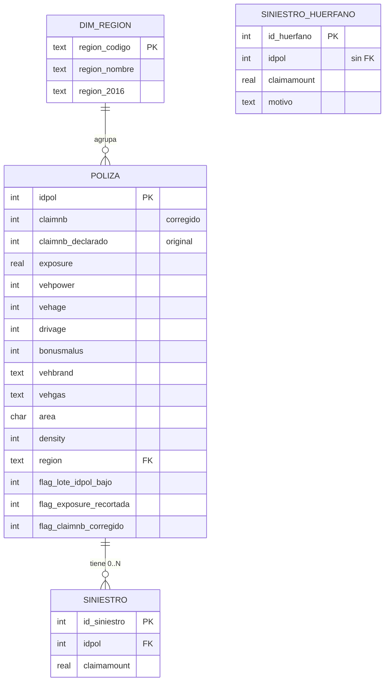

# 3. Modelo y almacenamiento de los datos

## Base de datos

Usamos SQLite: toda la base es un único archivo (`db/seguros.db`) y no hace falta instalar ningún
servidor. Se puede abrir desde Python o desde DBeaver. Para el volumen que tenemos (unas 700 mil
filas) alcanza de sobra, y cualquiera del grupo la puede regenerar con un comando.

## Tres capas

Organizamos las tablas en tres capas, siguiendo la idea de la arquitectura Medallion que vimos en
clase (bronze, silver y gold). Como SQLite no tiene esquemas, la capa se indica con un prefijo en el
nombre de cada tabla.

| Prefijo | Capa | Qué tiene | Regla |
|---------|------|-----------|-------|
| `raw_` | bronze | Copia fiel de los dos CSV | No se corrige nada. |
| `core_` | silver | Pólizas y siniestros limpios, con claves primarias y foráneas | Solo entran datos que cumplen las reglas. |
| `mart_` | gold | Tablas planas listas para el análisis y para Power BI | Pensadas para responder la pregunta del caso. |

Trabajar así tiene tres ventajas. Podemos mostrar el antes y el después de la limpieza (`raw_`
contra `core_`). Si una limpieza sale mal, no perdemos nada, porque `raw_` queda intacta. Y cada capa
tiene una sola función, lo que hace más fácil revisarla y explicarla.

## Capa raw (`sql/01_raw_tables.sql`)

| Tabla | Viene de | Cada fila es | Filas |
|-------|----------|--------------|------:|
| `raw_freq` | `freMTPL2freq.csv` | una póliza | 678.013 |
| `raw_sev` | `freMTPL2sev.csv` | un siniestro | 26.639 |

Las cantidades coinciden con los CSV; el script de carga lo controla al terminar.

Decisiones que tomamos en esta capa:

- No definimos claves primarias ni foráneas, porque todavía no sabemos si los datos las cumplen. Eso
  es justamente lo que medimos en el control de calidad.
- Guardamos `raw_freq.idpol` como texto. Hay una fila con el valor `1.00E+05` y, si la columna fuera
  entera, SQLite la convertiría sola a 100000 sin avisar. Eso borraría la evidencia del problema: en
  `raw_` queremos el dato tal como vino, y la corrección tiene que verse recién en `core_`.
- El único cambio es que pasamos los nombres de columna a minúscula.

Al convertir ese `IDpol` de texto a número nos encontramos con una trampa de SQLite.
`CAST('1.00E+05' AS INTEGER)` devuelve 1, porque solo lee los dígitos del principio. Para obtener
100000 hay que pasar primero por decimal: `CAST(CAST('1.00E+05' AS REAL) AS INTEGER)`. Con la primera
forma, esa póliza se habría unido sin ningún error con los siniestros de la póliza 1. Por eso todas
las consultas usan la segunda.

## Capa core (`sql/02_core_tables.sql`)

Se carga con `sql/20_limpieza_core.sql` (ver documento 5).

| Tabla | Cada fila es | Clave primaria | Clave foránea |
|-------|--------------|----------------|---------------|
| `core_dim_region` | una región, con su nombre oficial y su región de 2016 | `region_codigo` | |
| `core_poliza` | una póliza | `idpol` | `region` hacia `core_dim_region` |
| `core_siniestro` | un siniestro | `id_siniestro` | `idpol` hacia `core_poliza` |
| `core_siniestro_huerfano` | un siniestro cuya póliza no existe | `id_huerfano` | ninguna, a propósito |

Algunas decisiones:

- La tabla de siniestros original no tiene un identificador propio (una misma póliza se repite
  varias veces), así que le generamos uno: `id_siniestro`.
- `core_poliza` guarda el conteo de siniestros corregido (`claimnb`) y también el original
  (`claimnb_declarado`), además de columnas `flag_` (0 o 1) que marcan qué registros se corrigieron o
  son sospechosos.
- Las reglas de negocio están como restricciones `CHECK` (por ejemplo `bonusmalus BETWEEN 50 AND 350`,
  `drivage >= 18`, `claimamount > 0`). Así la base rechaza un dato inválido en lugar de aceptarlo en
  silencio.
- En SQLite las claves foráneas vienen desactivadas por defecto. `src/db.py` ejecuta
  `PRAGMA foreign_keys = ON;` en cada conexión. Si alguien carga datos desde DBeaver, tiene que
  activarlo a mano.

### Los siniestros huérfanos

En la tabla de siniestros hay 195 registros cuyo `IDpol` no existe en la tabla de pólizas (son de 6
pólizas). La clave foránea de `core_siniestro` exige que todo siniestro tenga su póliza, así que
SQLite no dejaría cargarlos.

| Opción | A favor | En contra |
|--------|---------|-----------|
| No crear la clave foránea | Se carga todo | Perdemos el control de integridad y el problema queda escondido. |
| Borrar los 195 | Es simple | Perdemos información y no queda registro de por qué. |
| Pasarlos a una tabla aparte | Mantenemos la clave y el dato | Es una tabla más. |

Elegimos la tercera: los siniestros con póliza van a `core_siniestro` y los huérfanos a
`core_siniestro_huerfano`, con el motivo. De esa forma podemos decir cuántos son y cuánto monto
representan.

## Capa mart (`sql/30_mart.sql` y `sql/31_mart_powerbi.sql`)

| Tabla | Para qué |
|-------|----------|
| `mart_poliza_analitica` | La tabla principal: una fila por póliza, con sus siniestros y montos ya sumados, el monto con tope, las franjas de edad, BonusMalus y antigüedad del vehículo, la región y las marcas de calidad. |
| `mart_siniestro` | Una fila por siniestro, con el monto real y el monto con tope. |
| `mart_parametro` | El percentil y el valor del tope con el que se armó el mart. |
| `mart_pareto`, `mart_calidad_hallazgos`, `mart_calidad_antes_despues`, `mart_dim_region_mapa` | Tablas chicas para el dashboard (curva de Pareto, resumen de calidad y coordenadas de las regiones). |

Power BI no tiene un conector propio para SQLite, así que estas tablas se exportan a CSV en la
carpeta `export/` (ver documento 6).

## Relación entre pólizas y siniestros

Una póliza tiene cero, uno o varios siniestros (el 95 % no tiene ninguno). Esto hay que tenerlo en
cuenta al hacer un `JOIN`: si se unen pólizas con siniestros sin agrupar antes, una póliza con tres
siniestros aparece tres veces y su exposición se suma tres veces. Este error (fan-out) lo mostramos
en la consulta E7 de `sql/10_exploracion.sql`. Por eso en el mart primero sumamos los siniestros por
póliza y después unimos.

## Diagrama

