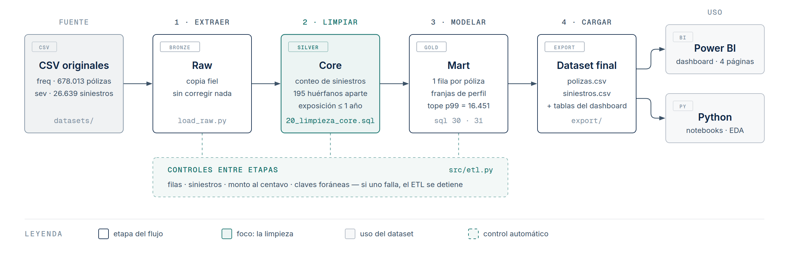

# 6. Flujo ETL

El ETL lleva los datos desde los CSV originales hasta el dataset que usan Power BI y los notebooks.
Todo el flujo se corre con un solo comando:

```bash
python src/etl.py            # con el tope de siniestros grandes en el percentil 99
python src/etl.py 0.995      # con otro percentil
```

Tarda unos 10 segundos, arma la base desde cero y deja los archivos finales en `export/`, junto con
un registro de la corrida en `export/etl_log.txt`. Para mostrarlo paso a paso, con el resultado de
cada etapa, está `notebooks/00_etl_demo.ipynb`.

## Diagrama



## Etapas

| # | Etapa | Qué hace | Archivos | Control al terminar |
|---|---|---|---|---|
| 1 | Extraer | Borra la base anterior y copia los dos CSV a `raw_` sin corregir nada. | `src/load_raw.py`, `sql/01_raw_tables.sql` | Las filas de cada CSV son las mismas que en `raw_` (678.013 y 26.639). |
| 2 | Limpiar | Arma `core_` con las decisiones de calidad: corrige el conteo de siniestros, aparta los huérfanos, convierte el `IDpol` mal escrito, recorta la exposición, normaliza las regiones y agrega las marcas. | `src/build_core.py`, `sql/02_core_tables.sql`, `sql/20_limpieza_core.sql` | No se pierde ninguna póliza, los siniestros de `core_` más los huérfanos dan el total, no hay claves foráneas rotas ni pólizas con conteo inconsistente. |
| 3 | Modelar | Calcula el tope de los siniestros grandes, lo aplica a cada siniestro y arma la tabla de una fila por póliza con sus franjas. Primero suma y después une, para no duplicar filas. | `src/build_mart.py`, `sql/30_mart.sql`, `sql/31_mart_powerbi.sql` | Pólizas, siniestros y monto total (al centavo) son iguales en `core_` y en `mart_`. |
| 4 | Cargar | Exporta a CSV el mart y las tablas chicas del dashboard. Todas se calculan en SQL: no hay números escritos a mano. | `src/build_mart.py` | |

Si cualquier control falla, el ETL se detiene con el mensaje `ETL DETENIDO`. Así nunca queda en
`export/` un dataset que no cierra.

## Archivos que genera (`export/`)

| Archivo | Filas | Para qué |
|---|---:|---|
| `polizas.csv` | 678.013 | El dataset final: una fila por póliza. Lo usan Power BI y el EDA. |
| `siniestros.csv` | 26.444 | Una fila por siniestro, con el monto real y con tope. |
| `parametros.csv` | 2 | Con qué percentil y qué tope se armó. |
| `pareto.csv` | 101 | Curva de concentración del costo (H3). |
| `calidad_antes_despues.csv` | 3 | Frecuencia y prima pura antes y después de la limpieza. |
| `calidad_hallazgos.csv` | 13 | Resumen de los problemas de calidad y qué se hizo. |
| `dim_region.csv` | 13 | Latitud y longitud de cada región, para el mapa. |
| `etl_log.txt` | | Registro de la última corrida, con todos los controles. |

## Decisiones

- **Siempre desde cero.** El ETL borra la base y vuelve a empezar desde los CSV. Así el resultado no
  depende de cambios que alguien haya hecho a mano.
- **Python y SQL.** Python se encarga de orquestar, cargar los archivos y calcular el percentil
  (SQLite no tiene una función para eso). Las transformaciones están en archivos `.sql`, que se pueden
  leer y explicar por separado.
- **Los CSV originales no se modifican nunca**, y `raw_` es una copia fiel. Eso es lo que nos permite
  mostrar el antes y el después.
- **El tope es un parámetro.** Elegimos el percentil 99 (16.451 €), pero se puede cambiar al correr el
  ETL sin tocar el código.
- **Es reproducible.** Dos corridas con los mismos CSV dan archivos idénticos: lo comprobamos
  comparando `polizas.csv` y `siniestros.csv` byte por byte.
