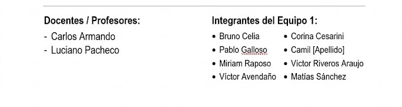
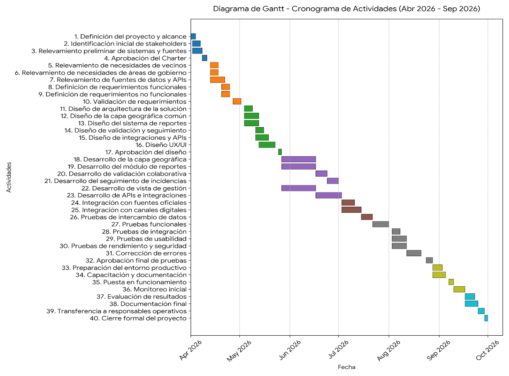

# ÍNDICE

- **Carátula** ................................................................................................... pág. 1

- **Índice** ....................................................................................................... pág. 2

- **Canvas del proyecto** ................................................................................ pág. 3

- **Aplicación de Design Thinking** ................................................................ pág. 4

- **Project Charter** ........................................................................................ pág. 5  
5.1. Identificación del proyecto  
5.2. Propósito y justificación  
5.3. Problema  
5.4. Objetivos  
5.5. Alcance  
5.6. Entregables  
5.7. Criterios de éxito y aceptación  
5.8. Recursos y presupuesto preliminar  
5.9. Riesgos iniciales y gestión del cambio  
5.10. Supuestos y restricciones  
5.11. Organización y roles iniciales  
5.12. Cronograma e hitos principales

- **Gantt del proyecto** .............................................................................. pág. 26  
6.1. Cronograma general  
6.2. Relación entre fases  
6.3. Hitos de control

- **Matriz de Stakeholders** ....................................................................... pág. 29  
7.1. Identificación y análisis de stakeholders  
7.2. Clasificación de stakeholders  
7.3. Stakeholders críticos  
7.4. Actores comerciales y evolución futura

- **Plan de Comunicación** ........................................................................ pág. 32  
8.1. Matriz de comunicación  
8.2. Comunicación según etapa  
8.3. Principios de comunicación  
8.4. Gestión de comunicaciones críticas

- **Gestión de Riesgos - Matriz de Riesgos** ............................................. pág. 35  
9.1. Metodología de evaluación  
9.2. Matriz de riesgos  
9.3. Acciones preventivas y planes de contingencia  
9.4. Priorización de riesgos  
9.5. Seguimiento y actualización de la matriz  
9.6. Criterios de control

- **Gestión de Costos - Presupuesto** ...................................................... pág. 41  
10.1. Criterios y supuestos de costos  
10.2. Recursos humanos  
10.3. Desarrollo y tecnología  
10.4. Datos, GIS e integraciones  
10.5. Infraestructura y seguridad  
10.6. Implementación y capacitación  
10.7. Mantenimiento inicial  
10.8. Contingencia  
10.9. Presupuesto total

**Anexos** ............................................................pág. 26 (sujeto a aprobación del grupo)

- Anexo A. Gantt completo en Excel

**5. PROJECT CHARTER**

**5.1. Identificación del proyecto**

**Nombre del proyecto:**  
Modernización del Mapa Interactivo de la Ciudad

**Tipo de proyecto:**  
Proyecto de transformación y modernización digital de un servicio público.

**Metodología de gestión:**  
Metodología en cascada (Waterfall), con etapas, actividades y entregables definidos previamente y una secuencia de ejecución planificada.

**Organización / contexto:**  
Gobierno de la Ciudad de Buenos Aires, en el marco de la modernización de sus servicios digitales y de los canales de acceso a información georreferenciada.

**Equipo responsable:**  
Equipo de proyecto multidisciplinario, integrado por perfiles de gestión de proyectos, tecnología, datos, diseño y comunicación.

**Duración:**  
6 meses (24 semanas).

**Fecha de inicio:**  
10 de abril de 2026 (o la fecha exacta de Aprobación del Charter).

**Fecha de finalización:**  
30 de septiembre de 2026 (o la fecha del hito final de cierre)

**Descripción breve del proyecto**

A partir de la solución elegida en el proceso de Design Thinking y el Canvas de Plataforma Multilateral, formalizamos el Project Charter:

El proyecto propone modernizar el Mapa Interactivo de la Ciudad mediante la incorporación de una **capa geográfica común**, capaz de centralizar y organizar información proveniente de diferentes áreas y sistemas.

Esta capa permitirá que la información georreferenciada pueda ser utilizada por distintos canales digitales de la Ciudad, incluyendo el Mapa Interactivo y, sujeto a validación técnica, canales conversacionales como **Boti y BAX**.

Además, se propone incorporar un mecanismo de **reportes ciudadanos georreferenciados**, mediante el cual los vecinos puedan informar incidencias de su entorno, como calles cortadas, obstáculos o vehículos detenidos. Estos reportes podrán ser visualizados, validados por otros usuarios y derivados para su gestión, permitiendo actualizar su estado hasta su resolución.

De esta manera, el proyecto busca transformar el mapa de una herramienta principalmente consultiva en una **plataforma geográfica común**, que conecte información oficial, canales digitales y participación ciudadana.

## 5.2. Propósito y justificación

### 5.2.1 Propósito del proyecto

El propósito del proyecto es modernizar el Mapa Interactivo de la Ciudad para convertirlo en una **plataforma geográfica común**, capaz de integrar información proveniente de diferentes áreas y sistemas, facilitar su acceso desde distintos canales digitales y permitir una mayor participación de los vecinos.

La propuesta busca que la ubicación geográfica funcione como un elemento común para organizar y relacionar información de la ciudad. De esta manera, un vecino podrá acceder a información relevante de su entorno sin necesidad de conocer previamente qué área del Gobierno de la Ciudad administra cada servicio ni qué canal debe utilizar para realizar una consulta o un reporte.

El proyecto también busca incorporar un mecanismo de **participación ciudadana georreferenciada**, mediante el cual los vecinos puedan informar incidencias que ocurren en la vía pública y consultar su evolución. Los reportes podrán ser validados por otros usuarios y derivados a las áreas correspondientes para su gestión.

### 5.2.2 Justificación

Durante el proceso de Design Thinking se identificó como problema principal la **dispersión de información entre diferentes canales, áreas y sistemas**, situación que dificulta el acceso rápido del vecino a información relevante de su zona.

Actualmente, una persona puede necesitar consultar información, realizar un reclamo o conocer una situación determinada de su entorno sin saber previamente qué organismo es responsable ni dónde se encuentra disponible esa información. Esta situación genera una experiencia fragmentada y obliga al ciudadano a realizar búsquedas en diferentes canales.

Frente a este problema, el proyecto propone utilizar el componente geográfico como punto de integración. En lugar de desarrollar soluciones independientes para cada área, se plantea una **capa geográfica reutilizable** que permita centralizar información y ponerla a disposición de diferentes servicios y canales digitales.

La incorporación de reportes ciudadanos agrega además una dimensión participativa al proyecto. El vecino no solamente consulta información existente, sino que puede aportar información sobre situaciones que ocurren en su entorno. La posibilidad de validar y actualizar estos reportes permite construir un flujo de información que conecta al ciudadano con las áreas responsables de la gestión.

La integración con canales digitales existentes, como Boti y BAX, se plantea como una posibilidad para ampliar los puntos de acceso a la información sin obligar al ciudadano a utilizar exclusivamente el Mapa Interactivo. La validación técnica y el alcance concreto de estas integraciones deberán definirse durante las etapas iniciales del proyecto.

En consecuencia, el proyecto busca pasar de un modelo de información distribuida hacia un modelo basado en una **identidad geográfica común**, donde el mapa funcione como infraestructura de información y conexión entre ciudadanos, datos, servicios y áreas de gestión.

## 5.3. Problema

La información relacionada con servicios, incidencias y actividades de la Ciudad se encuentra distribuida entre diferentes áreas, sistemas y canales digitales. Esta fragmentación dificulta que los vecinos puedan acceder rápidamente a información relevante de su entorno y, en determinados casos, los obliga a identificar previamente qué organismo es responsable y qué canal deben utilizar.

La situación se vuelve especialmente relevante frente a acontecimientos que cambian rápidamente en el espacio público, como calles cortadas, vehículos detenidos, obstáculos, obras u otras incidencias. En estos casos, la información puede resultar útil tanto para el vecino que necesita conocer qué ocurre en su zona como para las áreas responsables de gestionar la situación.

A su vez, los mecanismos actuales de consulta y reporte no necesariamente comparten una misma referencia geográfica. Esto puede generar información duplicada, dificultades para relacionar datos provenientes de diferentes sistemas y una experiencia fragmentada para el ciudadano.

El problema central identificado es, por lo tanto:

**La falta de una capa geográfica común que permita integrar información de diferentes áreas y canales, dificultando el acceso del vecino a información actualizada y geolocalizada y limitando la posibilidad de conectar los reportes ciudadanos con la gestión de las incidencias.**

### 5.3.1 Consecuencias del problema

La situación identificada puede generar las siguientes consecuencias:

- Dificultad para encontrar información relevante de una zona determinada.

- Necesidad de utilizar diferentes canales para realizar consultas o reportes.

- Falta de visibilidad sobre el estado y evolución de determinadas incidencias.

- Posible duplicación de información o soluciones geográficas desarrolladas de manera independiente por distintas áreas.

- Dificultad para relacionar los reportes ciudadanos con la información oficial disponible.

- Mayor esfuerzo por parte del ciudadano para identificar el canal o área correspondiente.

- Menor aprovechamiento de la información geográfica como recurso transversal entre diferentes servicios digitales.

### 5.3.2 Oportunidad de mejora

El problema identificado representa una oportunidad para utilizar la **ubicación geográfica como elemento común de integración** entre información oficial, canales digitales y participación ciudadana.

La modernización propuesta permitiría avanzar hacia un modelo en el cual una misma capa geográfica pueda ser utilizada por diferentes servicios, mientras que los vecinos puedan consultar información, generar reportes y conocer su estado desde los canales disponibles.

De esta forma, el proyecto no busca únicamente actualizar una interfaz de mapa, sino **transformar la función del mapa dentro del ecosistema digital de la Ciudad**, convirtiéndolo en una fuente común de información georreferenciada.

## 5.4. Objetivos del proyecto

### 5.4.1 Objetivo general

**Modernizar el Mapa Interactivo de la Ciudad mediante el desarrollo de una capa geográfica común que integre información oficial, facilite su acceso desde diferentes canales digitales y permita a los vecinos reportar, validar y consultar incidencias geolocalizadas, mejorando la disponibilidad y trazabilidad de la información relacionada con su entorno.**

### 5.4.2 Objetivos específicos

**1. Centralizar la información georreferenciada**

Diseñar e implementar una estructura de datos geográfica común que permita integrar información proveniente de diferentes áreas y fuentes oficiales, estableciendo criterios de organización, actualización y disponibilidad.

**2. Integrar la información geográfica con distintos canales digitales**

Desarrollar mecanismos de integración mediante APIs que permitan que la información georreferenciada pueda ser consultada y utilizada desde el Mapa Interactivo y otros canales digitales seleccionados, incluyendo Boti y BAX, sujeto a validación técnica.

**3. Implementar un sistema de reportes ciudadanos georreferenciados**

Desarrollar una funcionalidad que permita a los vecinos informar incidencias de la vía pública mediante su ubicación geográfica, categoría, fecha y hora, incorporando información adicional cuando corresponda.

**4. Incorporar mecanismos de validación colaborativa**

Permitir que otros usuarios puedan confirmar, actualizar o informar la desaparición de una incidencia reportada, utilizando la participación ciudadana como mecanismo complementario para mantener actualizada la información.

**5. Implementar un sistema de seguimiento de incidencias**

Definir un flujo que permita registrar y visualizar el estado de cada reporte desde su creación hasta su resolución o cierre, facilitando la trazabilidad de la incidencia.

**6. Facilitar la gestión de información por parte de las áreas responsables**

Proporcionar mecanismos que permitan a las áreas correspondientes acceder a los reportes y a la información geográfica relevante para su ámbito de gestión.

**7. Establecer criterios de calidad y gobernanza de los datos**

Definir responsables, criterios de actualización, fuentes de información y mecanismos de control que permitan mantener la calidad, consistencia y actualidad de los datos utilizados por la plataforma.

**8. Mejorar el acceso del vecino a información relevante de su entorno**

Reducir la necesidad de que el ciudadano conozca previamente qué organismo o canal debe utilizar para acceder a información geolocalizada, centralizando la consulta y facilitando el acceso desde diferentes puntos de interacción.

*NOTA: Para el TP, yo los mantendría porque están bien conectados con el proyecto, pero después podemos agruparlos en **4 grandes resultados**:

| **Objetivos** | **Resultado** |
|---|---|
| 1 + 7 | **Capa geográfica confiable** |
| 2 | **Integración multicanal** |
| 3 + 4 + 5 | **Sistema de reportes y seguimiento** |
| 6 + 8 | **Mejor gestión y experiencia del vecino** |

Y eso nos va a servir muchísimo cuando hagamos el **Gantt**, porque podemos convertir esos cuatro resultados en grandes paquetes de trabajo.

Además, hay una diferencia importante respecto de lo que tenían originalmente: **el objetivo no es "hacer un mapa"**. El mapa ya existe. El proyecto consiste en **modernizarlo y convertirlo en una infraestructura geográfica común**, con participación ciudadana e integración con otros canales.

## 5.5. Alcance del proyecto

### 5.5.1 Alcance incluido

El proyecto comprende la modernización del Mapa Interactivo de la Ciudad como una plataforma geográfica común para integrar información oficial, facilitar el acceso desde diferentes canales digitales y habilitar mecanismos de participación ciudadana.

Dentro del alcance se incluyen las siguientes actividades y componentes:

- **Desarrollo de una capa geográfica común**  
Diseño e implementación de una estructura geográfica que permita relacionar y visualizar información proveniente de diferentes áreas y sistemas de la Ciudad.

- **Integración de información oficial**  
Relevamiento e integración de fuentes de datos y APIs seleccionadas, estableciendo criterios de actualización, responsables y mecanismos básicos de control de calidad.

- **Integración con canales digitales**  
Desarrollo de los mecanismos necesarios para que la información geográfica pueda ser consultada y utilizada desde diferentes canales digitales de la Ciudad, incluyendo el Mapa Interactivo y canales conversacionales seleccionados, como Boti y BAX, sujetos a validación técnica y de alcance.

- **Sistema de reportes ciudadanos georreferenciados**  
Implementación de una funcionalidad que permita a los vecinos informar incidencias de su entorno, como vehículos detenidos, obstrucciones, cortes u otros eventos relevantes, asociando cada reporte con una ubicación geográfica y una categoría.

- **Validación colaborativa de reportes**  
Incorporación de mecanismos para que otros usuarios puedan confirmar, actualizar o indicar que una incidencia ya no se encuentra presente, contribuyendo a mantener actualizada la información.

- **Seguimiento del estado de las incidencias**  
Definición de un flujo que permita registrar el ciclo de vida de un reporte, desde su creación y validación hasta su derivación, resolución y cierre cuando corresponda.

- **Vista de gestión para las áreas responsables**  
Desarrollo de una funcionalidad básica que permita a las áreas correspondientes consultar los reportes asociados a su ámbito de responsabilidad y realizar su seguimiento.

- **Gobernanza y documentación**  
Definición de criterios básicos sobre fuentes de información, responsables, actualización de datos, tratamiento de reportes y documentación necesaria para el mantenimiento de la solución.

### 5.5.2 Alcance excluido

Quedan fuera del alcance del proyecto:

- Desarrollo o reemplazo completo de Boti, BAX u otros canales digitales existentes. La integración se limita a los mecanismos necesarios para utilizar la información y funcionalidades definidas por el proyecto.

- Reemplazo de los sistemas internos utilizados actualmente por las diferentes áreas de la Ciudad.

- Desarrollo de una aplicación de navegación vehicular o de un sistema equivalente a Waze. La funcionalidad de reportes se limita a la identificación, validación y seguimiento de incidencias georreferenciadas.

- Resolución automática de las incidencias reportadas. El proyecto contempla su registro, validación, derivación y seguimiento, pero no la ejecución física de las acciones necesarias para resolverlas.

- Incorporación de todas las fuentes de información existentes en la Ciudad. La integración se realizará sobre las fuentes seleccionadas durante la etapa de análisis.

- Desarrollo de funcionalidades comerciales, publicidad o monetización para usuarios finales, salvo que sean incorporadas posteriormente mediante una decisión formal de alcance.

- Implementación de funcionalidades de perfil personal avanzado o personalización basada en datos sensibles que no sean necesarias para los objetivos definidos.

- Expansión del proyecto a funcionalidades no relacionadas directamente con la integración geográfica, el acceso a información oficial y la gestión de incidencias ciudadanas.

### 5.5.3 Criterio general de alcance

El proyecto se considerará dentro de alcance cuando una funcionalidad contribuya directamente a alguno de los siguientes resultados:

- centralizar información geográfica oficial;

- facilitar su consulta desde diferentes canales;

- permitir reportar incidencias georreferenciadas;

- validar y mantener actualizados esos reportes;

- facilitar su seguimiento por parte de las áreas responsables.

Cualquier nueva funcionalidad que no contribuya directamente a estos resultados deberá ser evaluada como un cambio de alcance y, de corresponder, incorporada mediante el mecanismo de control de cambios definido para el proyecto.

## 5.6. Entregables principales

Como resultado del proyecto se prevé la generación de los siguientes entregables principales:

### 5.6.1 Capa geográfica común

Estructura geográfica centralizada que permita integrar, organizar y visualizar información proveniente de diferentes áreas y fuentes de la Ciudad.

**Incluye:**

- definición de la estructura geográfica;

- integración de fuentes seleccionadas;

- criterios de actualización;

- identificación de responsables de los datos;

- mecanismos básicos de control de calidad.

### 5.6.2 Integraciones con fuentes y canales digitales

Conjunto de integraciones necesarias para permitir el intercambio y consumo de información geográfica desde los sistemas y canales definidos dentro del alcance.

**Incluye:**

- APIs o mecanismos de intercambio seleccionados;

- integración con las fuentes oficiales priorizadas;

- integración con el Mapa Interactivo;

- integración con canales digitales seleccionados, incluyendo Boti y BAX, sujeta a validación técnica;

- documentación de las integraciones implementadas.

### 5.6.3 Módulo de reportes ciudadanos georreferenciados

Funcionalidad que permita a los vecinos registrar incidencias vinculadas a una ubicación determinada.

**Incluye:**

- creación de reportes;

- ubicación geográfica;

- categoría de incidencia;

- fecha y hora;

- información complementaria cuando corresponda;

- visualización del reporte en el mapa.

### 5.6.4 Sistema de validación colaborativa

Mecanismo mediante el cual otros usuarios puedan aportar información sobre una incidencia reportada.

**Incluye:**

- confirmación de una incidencia;

- indicación de que una incidencia continúa presente;

- indicación de que una incidencia ya no se encuentra presente;

- actualización del estado del reporte a partir de las interacciones recibidas.

### 5.6.5 Sistema de seguimiento de incidencias

Flujo de gestión que permita registrar la evolución de cada reporte desde su creación hasta su cierre.

**Estados principales previstos:**

**Reportado → Validado → Derivado → En gestión → Resuelto → Cerrado**

La definición definitiva de los estados podrá ajustarse durante la etapa de análisis y diseño, de acuerdo con los procesos de las áreas responsables.

### 5.6.6 Vista de gestión para áreas responsables

Interfaz básica destinada a las áreas de la Ciudad involucradas en la gestión de incidencias.

**Incluye:**

- consulta de reportes;

- visualización geográfica;

- filtrado por categoría y estado;

- seguimiento de incidencias;

- actualización del estado cuando corresponda.

### 5.6.7 Documentación técnica y funcional

Documentación necesaria para facilitar la implementación, operación y mantenimiento de la solución.

**Incluye:**

- documentación de arquitectura;

- documentación de APIs e integraciones;

- criterios de gobernanza de datos;

- descripción de funcionalidades;

- procedimientos básicos de operación y mantenimiento.

### 5.6.8 Plan de implementación y cierre

Conjunto de documentos y actividades necesarias para preparar la puesta en funcionamiento de la solución y realizar el cierre formal del proyecto.

**Incluye:**

- plan de implementación;

- documentación para las áreas involucradas;

- capacitación o transferencia de conocimientos cuando corresponda;

- registro de pruebas y resultados;

- evaluación inicial de funcionamiento;

- documentación de cierre del proyecto.

## 5.7. Criterios de éxito y aceptación

El éxito del proyecto se evaluará a partir del cumplimiento de los objetivos, entregables y condiciones definidas en el alcance. Los criterios permitirán verificar que la solución desarrollada sea funcional, integrable y utilizable por los actores involucrados.

### 5.7.1 Criterios de éxito

Se considerará que el proyecto alcanzó sus objetivos cuando se cumplan los siguientes criterios:

- **Integración de información geográfica**  
La solución deberá permitir integrar y visualizar información proveniente de las fuentes oficiales seleccionadas, utilizando una estructura geográfica común.

- **Disponibilidad multicanal**  
La información y las funcionalidades definidas para el proyecto deberán poder ser utilizadas desde el Mapa Interactivo y los canales digitales seleccionados, de acuerdo con las posibilidades técnicas de cada integración.

- **Funcionamiento del sistema de reportes**  
Los usuarios deberán poder generar reportes de incidencias asociados a una ubicación geográfica y a una categoría determinada.

- **Validación colaborativa**  
El sistema deberá permitir que otros usuarios interactúen con los reportes para confirmar su existencia o indicar que una incidencia ya no se encuentra presente.

- **Trazabilidad de las incidencias**  
Cada reporte deberá contar con un estado identificable y permitir registrar su evolución desde la creación hasta el cierre.

- **Acceso para las áreas responsables**  
Las áreas involucradas deberán disponer de una vista que permita consultar y realizar el seguimiento de los reportes correspondientes a su ámbito de responsabilidad.

- **Calidad y actualización de la información**  
Deberán estar definidos los responsables de las fuentes incorporadas, los criterios de actualización y los mecanismos básicos de control de calidad.

- **Documentación y transferencia**  
La solución deberá contar con documentación técnica y funcional suficiente para facilitar su implementación, operación y mantenimiento.

### 5.7.2 Criterios de aceptación

Los entregables serán considerados aceptados cuando hayan sido revisados y verificados mediante pruebas definidas durante las etapas de análisis y testing.

La aceptación deberá contemplar como mínimo:

- **Pruebas funcionales:** verificar que las funcionalidades respondan a los requerimientos definidos.

- **Pruebas de integración:** comprobar el correcto intercambio de información entre el mapa, las fuentes seleccionadas y los canales digitales involucrados.

- **Pruebas de reportes:** verificar la creación, geolocalización, visualización y actualización de incidencias.

- **Pruebas de validación:** comprobar el funcionamiento de los mecanismos de confirmación y actualización colaborativa.

- **Pruebas de seguimiento:** verificar que los estados de una incidencia puedan actualizarse y consultarse correctamente.

- **Pruebas de gestión:** comprobar que las áreas responsables puedan acceder a la información correspondiente y realizar el seguimiento definido.

- **Revisión de documentación:** verificar que la documentación técnica y funcional se encuentre completa y actualizada.

### 5.7.3 Condiciones de aceptación final

La aceptación final del proyecto estará condicionada a:

- cumplimiento del alcance aprobado;

- entrega de los componentes y documentos definidos;

- aprobación de las pruebas funcionales y de integración;

- resolución o aceptación formal de los defectos críticos identificados;

- disponibilidad de la documentación necesaria;

- validación por parte de los responsables definidos para el proyecto.

Los criterios específicos de rendimiento, disponibilidad, tiempos de respuesta y otros indicadores técnicos serán definidos durante la etapa de análisis, de acuerdo con los requerimientos no funcionales y las características de la solución.

**5.8. Recursos y presupuesto preliminar**

La ejecución del proyecto requerirá recursos humanos, tecnológicos y financieros destinados al desarrollo, integración, implementación y mantenimiento inicial de la solución.

**5.8.1 Recursos humanos**

El proyecto requerirá, como mínimo, la participación de los siguientes perfiles:

- Responsable o director del proyecto.

- Analistas funcionales.

- Desarrolladores de software.

- Especialistas en datos y APIs.

- Especialistas en sistemas de información geográfica.

- Diseñadores UX/UI.

- Especialistas en infraestructura y seguridad.

- Representantes de las áreas responsables de la información.

- Responsables de los canales digitales integrados.

- Personal destinado a pruebas y control de calidad.

- Personal de soporte y documentación.

La cantidad y dedicación de cada perfil será determinada durante la elaboración del cronograma y presupuesto detallado.

**5.8.2 Recursos tecnológicos**

Entre los principales recursos tecnológicos necesarios se consideran:

- Infraestructura para alojamiento de la solución.

- Bases de datos y servicios de almacenamiento.

- Servicios de mapas y georreferenciación.

- APIs y mecanismos de integración.

- Herramientas de desarrollo y testing.

- Sistemas de monitoreo y registro.

- Infraestructura necesaria para soportar los canales digitales integrados.

- Herramientas de seguridad y control de acceso.

**5.8.3 Categorías de costos**

El presupuesto detallado contemplará, como mínimo, las siguientes categorías:

| **Categoría** | **Conceptos principales** |
|---|---|
| **Desarrollo** | Análisis, programación, integración y testing |
| **Datos y GIS** | Procesamiento, almacenamiento y servicios geográficos |
| **Infraestructura** | Servidores, bases de datos y servicios tecnológicos |
| **Integraciones** | APIs, conexiones con fuentes y canales digitales |
| **Diseño y UX** | Investigación, diseño de interfaces y pruebas de usabilidad |
| **Seguridad** | Controles, auditorías y mecanismos de protección |
| **Implementación** | Puesta en funcionamiento, capacitación y soporte inicial |
| **Mantenimiento inicial** | Correcciones, monitoreo y ajustes posteriores a la implementación |
| **Gestión del proyecto** | Planificación, coordinación, seguimiento y documentación |

**5.8.4 Modelo de financiamiento**

La financiación principal del proyecto se considera inicialmente asociada al presupuesto destinado a la modernización de servicios digitales.

Adicionalmente, se podrá evaluar un modelo complementario de ingresos mediante la incorporación de servicios comerciales de terceros.

En una eventual etapa posterior, restaurantes, comercios y prestadores de servicios particulares podrían contratar espacios de **visibilidad patrocinada** dentro del mapa. Estos contenidos podrían mostrarse de acuerdo con criterios geográficos, por ejemplo, establecimientos ubicados en las proximidades del usuario.

La publicidad deberá diferenciarse claramente de la información oficial y no deberá alterar la información pública, los reportes ciudadanos ni los resultados de gestión.

Este modelo deberá ser evaluado en términos de:

- viabilidad económica;

- reglas de participación de los comercios;

- criterios de transparencia;

- diferenciación entre contenido oficial y patrocinado;

- protección de los datos de los usuarios;

- impacto sobre la experiencia de uso;

- mecanismos de control y moderación.

**5.8.5 Consideración sobre el alcance**

La incorporación de publicidad y servicios patrocinados no formará parte del núcleo funcional de la primera implementación, salvo que sea aprobada expresamente como parte del alcance definitivo.

En caso de incorporarse, deberá tratarse como un componente específico del modelo de negocio y generar los correspondientes requerimientos, tareas, costos, riesgos y criterios de aceptación.

Como alternativa, podrá considerarse una **fase posterior de evolución del proyecto**, una vez validado el funcionamiento de la plataforma y su utilización por parte de vecinos, áreas de gobierno y usuarios comerciales.

**5.9. Riesgos iniciales y gestión del cambio**

**5.9.1 Riesgos iniciales identificados**

Durante la definición inicial del proyecto se identifican los siguientes riesgos principales:

| **Riesgo** | **Posible consecuencia** | **Respuesta inicial** |
|---|---|---|
| **Disponibilidad insuficiente de APIs o fuentes de datos** | Retrasos o imposibilidad de integrar determinadas fuentes | Relevar las fuentes durante la etapa de análisis y definir alternativas |
| **Baja calidad o actualización de los datos** | Información incorrecta o desactualizada para los usuarios | Establecer responsables, criterios de actualización y controles de calidad |
| **Dificultades de integración con canales existentes** | Retrasos en la disponibilidad multicanal | Realizar validaciones técnicas tempranas y pruebas de integración |
| **Falta de coordinación entre áreas** | Demoras en decisiones, requerimientos o validaciones | Definir responsables y mecanismos formales de comunicación |
| **Aumento del alcance** | Incremento de costos y plazos | Aplicar un mecanismo formal de control de cambios |
| **Baja participación ciudadana** | Pocos reportes o validaciones colaborativas | Diseñar una experiencia simple y mecanismos de incentivo al uso |
| **Reportes incorrectos o maliciosos** | Información poco confiable | Incorporar mecanismos de validación, moderación y seguimiento |
| **Problemas de rendimiento o disponibilidad** | Dificultades de acceso a la plataforma | Definir requerimientos técnicos y realizar pruebas de rendimiento |
| **Limitaciones presupuestarias** | Reducción o postergación de funcionalidades | Priorizar entregables y controlar costos durante el proyecto |
| **Riesgos relacionados con datos de usuarios** | Incumplimientos o pérdida de confianza | Minimizar datos recolectados y aplicar controles de seguridad y privacidad |
| **Baja adopción por parte de comercios** | Menores ingresos por servicios patrocinados | Evaluar el modelo comercial como una fase posterior y validar su aceptación |
| **Confusión entre contenido oficial y patrocinado** | Pérdida de claridad para los usuarios | Identificar visualmente los contenidos comerciales y establecer reglas de publicación |

**5.9.2 Gestión de cambios**

Debido a que el proyecto será desarrollado bajo una metodología en cascada, cualquier modificación significativa respecto del alcance aprobado deberá ser evaluada antes de su incorporación.

Una solicitud de cambio deberá analizar, como mínimo:

- impacto sobre el alcance;

- impacto sobre el cronograma;

- impacto sobre los costos;

- impacto sobre los recursos necesarios;

- impacto sobre los riesgos;

- impacto sobre los entregables;

- impacto sobre la calidad y los criterios de aceptación.

Los cambios podrán ser:

**Cambios menores:** aquellos que no alteren significativamente los objetivos, entregables, presupuesto o cronograma. Podrán ser gestionados dentro del equipo del proyecto según las responsabilidades definidas.

**Cambios significativos:** aquellos que modifiquen el alcance, agreguen funcionalidades importantes, impliquen nuevos actores o requieran recursos adicionales. Deberán contar con la evaluación y aprobación de los responsables correspondientes.

**5.9.3 Control del alcance**

Para evitar el crecimiento no planificado del proyecto, toda funcionalidad nueva deberá ser evaluada en relación con los objetivos definidos en este Charter.

En particular, funcionalidades como:

- publicidad y contenido patrocinado;

- nuevas categorías de reportes;

- nuevos canales digitales;

- incorporación de nuevas fuentes de datos;

- perfiles personalizados;

- funcionalidades comerciales;

deberán incorporarse únicamente cuando exista una decisión formal sobre su impacto y prioridad.

**5.9.4 Evolución futura**

La plataforma podrá evolucionar posteriormente hacia nuevas funcionalidades, siempre que estas sean compatibles con la arquitectura y los objetivos generales del proyecto.

Entre las posibles líneas de evolución se consideran:

- ampliación de fuentes de información;

- incorporación de nuevos canales digitales;

- nuevos tipos de reportes ciudadanos;

- mayor personalización de la información;

- servicios comerciales geolocalizados;

- recomendaciones de comercios y servicios;

- herramientas de análisis para las áreas de gobierno;

- nuevos mecanismos de participación ciudadana.

Estas funcionalidades se consideran oportunidades de evolución y no forman parte automáticamente del alcance de la primera implementación.

## 5.10. Supuestos y restricciones

### 5.10.1 Supuestos del proyecto

Para la planificación inicial del proyecto se consideran los siguientes supuestos:

- **Disponibilidad de información oficial**  
Las áreas seleccionadas pondrán a disposición las fuentes de información necesarias para la integración, de acuerdo con los permisos y mecanismos de acceso correspondientes.

- **Disponibilidad de APIs y servicios de intercambio**  
Se supone que las fuentes priorizadas cuentan con APIs u otros mecanismos técnicamente viables para permitir el intercambio de información requerido.

- **Participación de las áreas involucradas**  
Las áreas responsables de los datos y de la gestión de incidencias participarán en las etapas de análisis, validación, pruebas e implementación.

- **Disponibilidad de infraestructura tecnológica**  
Se contará con infraestructura suficiente para desarrollar, integrar, probar y poner en funcionamiento los componentes incluidos en el alcance.

- **Disponibilidad del equipo de proyecto**  
Los perfiles necesarios de gestión, tecnología, datos, diseño y comunicación estarán disponibles durante las etapas correspondientes.

- **Continuidad de los canales digitales seleccionados**  
Se supone que los canales digitales seleccionados para la integración estarán disponibles y contarán con mecanismos que permitan su vinculación con la solución, sujeto a validación técnica.

- **Participación de los vecinos**  
Se considera que los usuarios podrán aportar reportes y validaciones sobre incidencias de su entorno, generando información complementaria a las fuentes oficiales.

- **Disponibilidad de referencias geográficas comunes**  
Se supone que las fuentes seleccionadas pueden ser asociadas a una referencia geográfica común o adaptadas para su integración con la capa geográfica definida por el proyecto.

### 5.10.2 Restricciones del proyecto

El proyecto estará condicionado por las siguientes restricciones:

- **Alcance definido**  
El desarrollo deberá limitarse a las funcionalidades y componentes establecidos en el alcance aprobado, evitando incorporar funcionalidades que impliquen una ampliación no planificada.

- **Metodología de desarrollo**  
El proyecto será planificado y ejecutado bajo un enfoque de gestión en cascada, con etapas, entregables y puntos de aprobación definidos previamente.

- **Dependencia de sistemas externos**  
La integración con fuentes, APIs y canales digitales existentes dependerá de sus características técnicas, disponibilidad, permisos y condiciones de acceso.

- **Calidad y actualización de las fuentes**  
La solución dependerá de la calidad, frecuencia de actualización y disponibilidad de los datos proporcionados por las áreas responsables.

- **Presupuesto disponible**  
El desarrollo deberá realizarse dentro del presupuesto aprobado, considerando los costos de desarrollo, infraestructura, integración, mantenimiento inicial y demás recursos necesarios.

- **Plazos del proyecto**  
Las actividades deberán ejecutarse dentro del cronograma aprobado, respetando las dependencias entre etapas y los hitos establecidos.

- **Protección y tratamiento de datos**  
El diseño e implementación deberán contemplar las condiciones aplicables al tratamiento de datos de usuarios y reportes ciudadanos, evitando la incorporación de información que no resulte necesaria para los objetivos del proyecto.

- **Capacidad de los canales existentes**  
Las funcionalidades disponibles a través de canales como Boti y BAX estarán condicionadas por las capacidades técnicas y de integración que estos canales permitan.

### 5.10.3 Relación con la gestión de riesgos

Los supuestos y restricciones identificados deberán ser revisados durante la planificación y el seguimiento del proyecto, ya que cualquier cambio significativo puede afectar el alcance, el cronograma, los costos o la calidad de los entregables.

En particular, los siguientes aspectos serán considerados como fuentes potenciales de riesgo:

- falta de disponibilidad o cambios en las APIs;

- retrasos en la entrega de información por parte de las áreas;

- problemas de calidad o actualización de los datos;

- dificultades de integración con canales digitales existentes;

- disponibilidad limitada del equipo;

- cambios de alcance;

- restricciones presupuestarias;

- retrasos en las etapas de desarrollo, integración o pruebas.

## 5.11. Organización y roles iniciales del proyecto

El proyecto requiere la participación coordinada de perfiles de gestión, tecnología, datos, diseño y representantes de las áreas involucradas. La asignación detallada de responsables podrá ajustarse durante la planificación, pero se establecen inicialmente los siguientes roles:

### 5.11.1 Sponsor del proyecto

Responsable de brindar respaldo institucional al proyecto, validar sus objetivos generales y facilitar la disponibilidad de recursos y participación de las áreas involucradas.

**Responsabilidades principales:**

- aprobar los objetivos y el alcance general;

- facilitar la coordinación entre áreas;

- validar decisiones de alto nivel;

- aprobar cambios significativos de alcance, presupuesto o cronograma;

- participar en la aprobación de los principales hitos.

### 5.11.2 Director o responsable del proyecto

Responsable de la planificación, coordinación y seguimiento integral del proyecto.

**Responsabilidades principales:**

- elaborar y mantener el plan del proyecto;

- coordinar las diferentes etapas;

- realizar el seguimiento del cronograma;

- gestionar alcance, riesgos, recursos y costos;

- coordinar a los equipos involucrados;

- comunicar avances y desvíos;

- gestionar la aprobación de entregables.

### 5.11.3 Equipo de tecnología y desarrollo

Responsable del diseño técnico, desarrollo e integración de los componentes de la solución.

**Responsabilidades principales:**

- definir la arquitectura;

- desarrollar la capa geográfica;

- desarrollar el sistema de reportes y validación;

- implementar las integraciones;

- realizar pruebas técnicas;

- documentar los componentes desarrollados.

### 5.11.4 Equipo de datos y gobernanza

Responsable de analizar las fuentes de información y establecer criterios para su integración y mantenimiento.

**Responsabilidades principales:**

- relevar las fuentes disponibles;

- evaluar calidad y actualización de los datos;

- definir criterios de integración;

- establecer responsables de cada fuente;

- colaborar en la definición de estándares y controles de calidad;

- supervisar aspectos relacionados con la gobernanza de datos.

### 5.11.5 Equipo de diseño y experiencia de usuario

Responsable de diseñar la interacción de los usuarios con la solución y asegurar que las funcionalidades sean comprensibles y utilizables.

**Responsabilidades principales:**

- diseñar las interfaces;

- definir los flujos de consulta y reporte;

- incorporar las necesidades identificadas durante Design Thinking;

- realizar validaciones de usabilidad;

- colaborar en las pruebas con usuarios.

### 5.11.6 Representantes de las áreas de la Ciudad

Responsables de aportar conocimiento sobre los procesos, fuentes de información y gestión de incidencias correspondientes a cada área.

**Responsabilidades principales:**

- aportar información sobre procesos y sistemas existentes;

- validar requerimientos;

- identificar fuentes de datos relevantes;

- participar en las pruebas;

- validar el funcionamiento de las funcionalidades asociadas a su ámbito;

- colaborar en la definición de los circuitos de atención y cierre de incidencias.

### 5.11.7 Res.ponsables de canales digitales

Participantes vinculados con los canales seleccionados para la integración, como el Mapa Interactivo y los canales conversacionales definidos para el proyecto.

**Responsabilidades principales:**

- evaluar la factibilidad de las integraciones;

- definir mecanismos de intercambio de información;

- validar requerimientos técnicos;

- participar en las pruebas de integración;

- coordinar la implementación de los componentes correspondientes.

### 5.11.8 Usuarios y comunidad

Los vecinos constituyen los usuarios finales de la solución y, a través del sistema de reportes, también una fuente de información complementaria.

**Participación prevista:**

- consultar información georreferenciada;

- generar reportes;

- validar incidencias informadas por otros usuarios;

- aportar información sobre el estado de las incidencias;

- participar en pruebas de usabilidad cuando corresponda.

### 5.11.9 Estructura general de responsabilidad

La estructura inicial del proyecto puede representarse de la siguiente manera:

**Sponsor**  
↓  
**Responsable del proyecto**  
↓  
**Equipos especializados**  
→ Tecnología y desarrollo  
→ Datos y gobernanza  
→ Diseño y experiencia de usuario  
↓  
**Áreas responsables y canales digitales**  
↓  
**Usuarios y comunidad**

Esta estructura será utilizada como base para desarrollar posteriormente la matriz de stakeholders, donde se analizarán el nivel de interés, influencia, impacto y estrategia de comunicación de cada actor.

## 5.12. Cronograma e hitos principales

El proyecto se desarrollará bajo una metodología en cascada, organizando el trabajo en etapas secuenciales con entregables y puntos de aprobación definidos. El cronograma detallado será desarrollado posteriormente mediante el Gantt del proyecto.

### 5.12.1 Etapas principales

| **Etapa** | **Objetivo principal** | **Resultado esperado** |
|---|---|---|
| **1. Inicio** | Definir formalmente el proyecto, alcance, actores y condiciones iniciales | Proyecto definido y aprobado |
| **2. Análisis** | Relevar necesidades, fuentes, sistemas y requerimientos | Requerimientos funcionales y no funcionales |
| **3. Diseño** | Diseñar la arquitectura, capa geográfica y funcionalidades | Diseño funcional y técnico aprobado |
| **4. Desarrollo** | Construir los componentes definidos | Componentes desarrollados |
| **5. Integración** | Conectar fuentes, sistemas y canales seleccionados | Integraciones implementadas |
| **6. Pruebas** | Verificar funcionamiento, integración y usabilidad | Solución validada y correcciones realizadas |
| **7. Implementación** | Preparar y realizar la puesta en funcionamiento | Solución implementada |
| **8. Cierre** | Evaluar resultados, documentar y formalizar el cierre | Proyecto cerrado y documentación final |

### 5.12.2 Hitos principales

Se establecen inicialmente los siguientes hitos:

**Hito 1. Aprobación del Project Charter**  
Marca la aprobación formal del objetivo, alcance, entregables y condiciones generales del proyecto.

**Hito 2. Aprobación de requerimientos**  
Confirma las necesidades funcionales y no funcionales que deberán ser atendidas por la solución.

**Hito 3. Aprobación del diseño**  
Valida la arquitectura, la capa geográfica, el sistema de reportes y los mecanismos de integración.

**Hito 4. Finalización del desarrollo**  
Confirma que los componentes principales definidos en el alcance se encuentran construidos.

**Hito 5. Finalización de integraciones**  
Verifica que las fuentes y canales seleccionados se encuentren integrados de acuerdo con los requerimientos establecidos.

**Hito 6. Aprobación de pruebas**  
Confirma el cumplimiento de los criterios de aceptación y la resolución de los defectos críticos identificados.

**Hito 7. Puesta en funcionamiento**  
Marca la implementación de la solución en el entorno definido para su utilización.

**Hito 8. Cierre del proyecto**  
Formaliza la finalización del proyecto, incluyendo documentación, evaluación inicial y transferencia a los responsables de operación.

### 5.12.3 Dependencias principales

La planificación deberá respetar las siguientes dependencias:

**Inicio → Análisis → Diseño → Desarrollo → Integración → Pruebas → Implementación → Cierre**

Dentro de estas etapas podrán existir actividades paralelas cuando no exista una dependencia directa. Por ejemplo, determinadas tareas de diseño de la capa geográfica y del sistema de reportes podrán desarrollarse en paralelo una vez aprobados los requerimientos correspondientes.

La duración específica de cada etapa y actividad será definida en el Gantt, considerando recursos disponibles, dependencias técnicas, puntos de aprobación y posibles riesgos identificados.

**6. GANTT DEL PROYECTO COMPLETO**

**6.1 Criterios de planificación**

Tomando como base el alcance, los entregables principales y los 8 hitos definidos en el Project Charter, estructuramos la planificación temporal y las dependencias en el diagrama de Gantt

El cronograma del proyecto se organiza bajo una metodología **Cascada (Waterfall)**, por lo que las principales fases se desarrollan de manera secuencial. Cada etapa cuenta con actividades, dependencias y entregables definidos, y su finalización permite avanzar hacia la siguiente fase.

Dentro de cada fase pueden desarrollarse actividades en paralelo cuando no existe una dependencia directa entre ellas. El cronograma contempla las siguientes etapas:

- Inicio

- Análisis

- Diseño

- Desarrollo

- Integración

- Pruebas

- Implementación

- Cierre

Se establece como período tentativo del proyecto **abril a septiembre de 2026**, dejando octubre para la consolidación y entrega académica del trabajo y noviembre para la instancia de defensa.

Las fechas son una planificación académica estimativa y pueden ajustarse de acuerdo con la disponibilidad de los equipos, las validaciones de las áreas involucradas y las dependencias técnicas identificadas durante el proyecto.

**6.2 Cronograma detallado:**

**Anexo Cronograma Detallado de Trabajo y Diagrama de Gantt – Proyecto Modernización del Mapa Interactivo de la Ciudad**

**6.3 Hitos principales**

Los principales hitos del proyecto son:

| **Matriz** | **Fecha estimada** | **Resultado** |
|---|---|---|
| Charter aprobado | 10/04/2026 | Inicio formal del proyecto |
| Requerimientos aprobados | 01/05/2026 | Requerimientos funcionales y no funcionales validados |
| Diseño aprobado | 26/05/2026 | Arquitectura, capa geográfica, integraciones y UX definidos |
| Desarrollo completado | 02/07/2026 | Componentes principales desarrollados |
| Integraciones validadas | 21/07/2026 | Fuentes y canales integrados |
| Pruebas aprobadas | 27/08/2026 | Solución validada |
| Puesta en funcionamiento | 09/09/2026 | Solución disponible en producción |
| Cierre del proyecto | 30/09/2026 | Transferencia y cierre formal |

**6.4 Relación entre fases**

El flujo principal del proyecto queda representado de la siguiente manera:

**Inicio**  
↓  
**Análisis**  
↓  
**Diseño**  
↓  
**Desarrollo**  
↓  
**Integración**  
↓  
**Pruebas**  
↓  
**Implementación**  
↓  
**Cierre**

Dentro de cada etapa se permite el desarrollo paralelo de actividades que no presentan dependencias directas. Por ejemplo, durante Diseño pueden desarrollarse simultáneamente la arquitectura, la capa geográfica, el sistema de reportes y el diseño UX/UI.

**6.5 Hitos de control**

Para mantener el enfoque Waterfall, se establecen puntos de control antes de avanzar entre las principales etapas:

- **Gate 1:** aprobación del Project Charter.

- **Gate 2:** aprobación de requerimientos.

- **Gate 3:** aprobación del diseño.

- **Gate 4:** finalización del desarrollo e integraciones.

- **Gate 5:** aprobación de pruebas.

- **Gate 6:** autorización de puesta en producción.

- **Gate 7:** cierre y transferencia operativa.

Estos puntos de control permiten verificar que los entregables de cada etapa cumplan con los criterios definidos antes de continuar con la siguiente fase.

## 7. Matriz de Stakeholders

## Para llevar a cabo las actividades planificadas en el cronograma de Gantt y garantizar la adopción de la plataforma, identificamos y analizamos a los principales stakeholders

Para el desarrollo del proyecto se identifican los principales actores que pueden afectar, verse afectados o tener capacidad de decisión sobre la modernización del Mapa Interactivo de la Ciudad.

La matriz permite determinar el nivel de interés e influencia de cada stakeholder y establecer una estrategia de gestión adecuada.

### 7.1 Identificación y análisis de stakeholders

| **Stakeholder** | **Tipo** | **Interés** | **Influencia** | **Impacto** | **Estrategia** |
|---|---|---|---|---|---|
| **Sponsor del proyecto** | Interno | Alto | Alto | Alto | Gestionar de cerca |
| **Responsable del proyecto** | Interno | Alto | Alto | Alto | Gestionar de cerca |
| **Equipo de tecnología y desarrollo** | Interno | Alto | Alto | Alto | Gestionar de cerca |
| **Equipo de datos y gobernanza** | Interno | Alto | Alto | Alto | Gestionar de cerca |
| **Equipo UX/UI** | Interno | Alto | Medio | Alto | Mantener involucrado |
| **Áreas responsables de la información** | Interno | Alto | Alto | Alto | Gestionar de cerca |
| **Responsables de canales digitales** | Interno/externo | Alto | Alto | Alto | Gestionar de cerca |
| **Vecinos y usuarios finales** | Externo | Alto | Medio | Alto | Mantener informados e involucrados |
| **Usuarios que realizan reportes** | Externo | Alto | Medio | Alto | Facilitar participación y feedback |
| **Usuarios que validan reportes** | Externo | Medio/Alto | Medio | Medio/Alto | Mantener involucrados |
| **Comercios y servicios locales** | Externo | Medio | Bajo/Medio | Medio | Mantener informados |
| **Potenciales anunciantes** | Externo | Medio | Bajo | Medio | Monitorear / gestionar según evolución |
| **Proveedores tecnológicos** | Externo | Medio | Medio | Medio | Mantener coordinados |
| **Áreas de comunicación institucional** | Interno | Medio/Alto | Medio/Alto | Medio/Alto | Mantener involucradas |

### 7.2 Clasificación por influencia e interés

Los stakeholders pueden organizarse en cuatro grupos según su nivel de influencia e interés:

#### Alta influencia / Alto interés

- Sponsor del proyecto.

- Responsable del proyecto.

- Equipo de tecnología.

- Equipo de datos y gobernanza.

- Áreas responsables de la información.

- Responsables de los canales digitales.

**Estrategia:** gestionar de cerca, involucrándolos en decisiones, aprobaciones, validaciones y seguimiento de avances.

#### Alta influencia / Bajo o medio interés

- Algunas áreas institucionales o de decisión que no participan diariamente del proyecto.

- Proveedores o responsables que intervienen en decisiones puntuales.

**Estrategia:** mantener satisfechos, proporcionando información suficiente y evitando sobrecargarlos con detalles operativos innecesarios.

#### Baja o media influencia / Alto interés

- Vecinos.

- Usuarios que realizan reportes.

- Usuarios que validan incidencias.

- Equipo UX/UI.

**Estrategia:** mantener involucrados, facilitar canales de participación y recoger información que permita mejorar la solución.

#### Baja influencia / Bajo o medio interés

- Comercios y servicios locales que no participen inicialmente del modelo comercial.

- Potenciales anunciantes.

- Otros actores externos que puedan incorporarse en futuras etapas.

**Estrategia:** monitorear su evolución y mantenerlos informados cuando sus intereses se relacionen con el proyecto.

### 7.3 Stakeholders críticos

Se consideran stakeholders críticos aquellos cuya participación resulta necesaria para que el proyecto pueda avanzar o cuyos intereses puedan afectar significativamente el resultado.

Los principales stakeholders críticos son:

- **Sponsor**, por su capacidad de decisión y respaldo institucional.

- **Responsable del proyecto**, por la coordinación general.

- **Equipo de tecnología**, por el desarrollo e integración de la solución.

- **Equipo de datos**, por la disponibilidad y calidad de la información.

- **Áreas responsables de los datos e incidencias**, por su conocimiento y validación.

- **Responsables de los canales digitales**, por la factibilidad de las integraciones.

- **Vecinos y usuarios finales**, por ser los destinatarios principales y participantes del sistema de reportes.

### 7.4 Consideración sobre actores comerciales

En caso de incorporar en una etapa posterior servicios patrocinados, publicidad geolocalizada o recomendaciones de comercios, los comercios y anunciantes pasarán a tener mayor relevancia dentro de la matriz de stakeholders.

Su nivel de interés podría aumentar debido a que la plataforma constituiría un nuevo canal de promoción geolocalizada.

La incorporación de este modelo deberá contemplar criterios de transparencia para diferenciar claramente los contenidos comerciales de la información oficial.

**8. Plan de Comunicación**

A partir de la clasificación y estrategias definidas en la Matriz de Stakeholders, diseñamos el Plan de Comunicación del proyecto para asegurar que la información relevante llegue de manera oportuna a cada actor, según su nivel de interés, influencia y participación.

La comunicación se organizará durante las diferentes etapas del proyecto y utilizará canales formales para las decisiones, aprobaciones y documentación, y canales operativos para el seguimiento cotidiano.

**8.1 Matriz de comunicación**

| **Información / Comunicación** | **Destinatarios** | **Responsable** | **Frecuencia** | **Canal** | **Objetivo** |
|---|---|---|---|---|---|
| Avance general del proyecto | Sponsor, responsable del proyecto, áreas involucradas | Responsable del proyecto | Quincenal | Informe de avance / reunión | Informar estado, avances y desvíos |
| Estado del cronograma | Equipo de proyecto, sponsor | Responsable del proyecto | Semanal | Gantt / reunión de seguimiento | Controlar tiempos y dependencias |
| Requerimientos | Tecnología, datos, UX/UI, áreas responsables | Responsable del proyecto + analistas | Durante etapa de análisis | Reuniones + documentación | Validar necesidades |
| Diseño de la solución | Tecnología, datos, UX/UI, áreas responsables | Equipo de diseño + tecnología | Por hito | Reunión de revisión | Obtener aprobación del diseño |
| Estado de desarrollo | Equipo de proyecto | Responsable de tecnología | Semanal | Reunión técnica / tablero de tareas | Detectar avances, bloqueos y desvíos |
| Integraciones y APIs | Tecnología, datos, responsables de canales | Equipo técnico | Según avance | Reunión técnica + documentación | Coordinar integraciones |
| Calidad y disponibilidad de datos | Datos, áreas responsables, tecnología | Equipo de datos | Quincenal / según necesidad | Informe técnico | Detectar problemas de calidad |
| Riesgos y problemas | Sponsor, responsable del proyecto, áreas involucradas | Responsable del proyecto | Quincenal o ante eventos críticos | Matriz de riesgos / reunión | Anticipar impactos y definir respuestas |
| Pruebas y resultados | Tecnología, UX/UI, áreas responsables, sponsor | Responsable de testing | Por etapa de pruebas | Informe de testing | Validar funcionamiento |
| Cambios de alcance | Sponsor, responsable del proyecto, áreas afectadas | Responsable del proyecto | Cuando se solicite un cambio | Solicitud formal / reunión | Evaluar impacto y aprobar o rechazar cambios |
| Puesta en funcionamiento | Áreas responsables, canales digitales, soporte | Responsable del proyecto | Previo a implementación | Reunión + documentación | Coordinar implementación |
| Capacitación y documentación | Áreas responsables y usuarios internos | Equipo de proyecto | Antes de implementación | Capacitación / manuales | Facilitar adopción |
| Información a vecinos | Usuarios finales | Área de comunicación | Antes y durante lanzamiento | Canales digitales institucionales | Comunicar disponibilidad y funcionamiento |
| Feedback de usuarios | Vecinos y usuarios | UX/UI + responsable del proyecto | Durante pruebas y luego del lanzamiento | Encuestas / formularios / canales digitales | Detectar problemas y oportunidades de mejora |

**8.2 Comunicación según etapa**

La comunicación se adaptará a cada fase del proyecto:

**Inicio**

- Presentación del proyecto.

- Confirmación de alcance y objetivos.

- Identificación de stakeholders.

- Aprobación del Project Charter.

**Análisis**

- Relevamiento de necesidades.

- Validación de requerimientos.

- Identificación de fuentes y dependencias.

- Comunicación de restricciones detectadas.

**Diseño**

- Presentación de arquitectura.

- Revisión de experiencia de usuario.

- Validación del modelo de reportes y seguimiento.

- Aprobación del diseño.

**Desarrollo e integración**

- Seguimiento del avance.

- Comunicación de bloqueos.

- Coordinación técnica.

- Actualización del cronograma.

**Pruebas**

- Comunicación de resultados.

- Registro y seguimiento de errores.

- Validación de criterios de aceptación.

- Aprobación de la solución.

**Implementación**

- Coordinación de la puesta en funcionamiento.

- Capacitación.

- Comunicación a usuarios.

- Seguimiento inicial.

**Cierre**

- Evaluación de resultados.

- Documentación final.

- Transferencia a responsables operativos.

- Comunicación del cierre del proyecto.

**8.3 Principios de comunicación**

El proyecto seguirá los siguientes principios:

- **Claridad:** la información deberá ser comprensible para el destinatario.

- **Oportunidad:** las comunicaciones deberán realizarse antes de que una decisión o problema genere impactos mayores.

- **Trazabilidad:** las decisiones importantes deberán quedar registradas.

- **Transparencia:** los avances, desvíos y riesgos relevantes deberán comunicarse a los responsables correspondientes.

- **Adecuación:** el nivel de detalle se adaptará al rol y necesidad de cada stakeholder.

- **Canalización formal de cambios:** las modificaciones relevantes del alcance, cronograma o presupuesto deberán quedar documentadas.

**8.4 Gestión de comunicaciones críticas**

Cuando se produzca un evento que pueda afectar significativamente el alcance, cronograma, presupuesto, calidad o implementación, se realizará una comunicación extraordinaria a los stakeholders correspondientes.

Se consideran situaciones críticas, entre otras:

- indisponibilidad de una fuente de datos fundamental;

- imposibilidad de realizar una integración prevista;

- retrasos significativos;

- aumento considerable del presupuesto;

- incorporación de nuevas funcionalidades;

- incidentes de seguridad;

- incumplimiento de criterios de aceptación;

- problemas que puedan afectar la puesta en funcionamiento.

La comunicación deberá incluir el problema detectado, su impacto potencial, las alternativas disponibles y la decisión adoptada.

**9. GESTIÓN DE RIESGOS - MATRIZ DE RIESGOS**

A partir del análisis de las actividades del camino crítico del Gantt y de las interacciones con los stakeholders, identificamos y priorizamos los riesgos del proyecto.

La gestión de riesgos tiene como objetivo identificar, analizar y controlar aquellos eventos que podrían afectar el alcance, cronograma, costos, calidad o implementación del proyecto de modernización del Mapa Interactivo de la Ciudad.

La gestión se realizará durante todo el ciclo de vida del proyecto, con especial atención a las etapas de análisis, integración, desarrollo y pruebas. Los riesgos identificados serán revisados periódicamente y podrán incorporarse nuevos riesgos a medida que avance el proyecto.

**9.1 Metodología de evaluación**

Para evaluar los riesgos se utilizarán dos variables principales:

**Probabilidad:** representa la posibilidad de que ocurra el riesgo.

- 1 = Muy baja

- 2 = Baja

- 3 = Media

- 4 = Alta

- 5 = Muy alta

**Impacto:** representa el efecto que tendría el riesgo sobre los objetivos del proyecto.

- 1 = Muy bajo

- 2 = Bajo

- 3 = Medio

- 4 = Alto

- 5 = Muy alto

El nivel de riesgo se obtiene mediante la siguiente fórmula:

**Nivel de riesgo = Probabilidad × Impacto**

La clasificación utilizada será:

| **Puntaje** | **Nivel** |
|---|---|
| 1–4 | Bajo |
| 5–9 | Medio |
| 10–16 | Alto |
| 17–25 | Crítico |

Los riesgos de nivel alto y crítico tendrán prioridad de seguimiento y deberán contar con acciones preventivas y planes de contingencia definidos.

**9.2 Matriz de riesgos**

| **ID** | **Riesgo** | **Causa** | **Consecuencia** | **Prob.** | **Impacto** | **Nivel** | **Respuesta** | **Responsable** |
|---|---|---|---|---|---|---|---|---|
| R01 | Falta de disponibilidad de APIs o fuentes necesarias | Las fuentes seleccionadas no cuentan con mecanismos adecuados de integración o acceso | No se puede incorporar determinada información al mapa | 3 | 5 | 15 - Alto | Mitigar | Tecnología + Datos |
| R02 | Baja calidad o desactualización de los datos | Las fuentes no poseen controles suficientes de actualización | Los usuarios podrían recibir información incorrecta o desactualizada | 4 | 5 | 20 - Crítico | Mitigar | Datos + áreas responsables |
| R03 | Problemas de integración entre sistemas | Diferencias técnicas, formatos o arquitecturas entre sistemas | Retrasos, errores de intercambio o funcionalidades incompletas | 3 | 4 | 12 - Alto | Mitigar | Tecnología |
| R04 | Falta de coordinación entre áreas | Diferentes prioridades, tiempos o responsables institucionales | Retrasos en validaciones, información y decisiones | 4 | 4 | 16 - Alto | Mitigar | Responsable del proyecto |
| R05 | Crecimiento no controlado del alcance | Incorporación de nuevas funcionalidades durante el desarrollo | Aumento de costos y plazos y pérdida de foco del proyecto | 4 | 5 | 20 - Crítico | Evitar / Mitigar | PM + Sponsor |
| R06 | Baja participación de los vecinos | Poco conocimiento de la funcionalidad o baja adopción | Menor cantidad de reportes y validaciones colaborativas | 3 | 3 | 9 - Medio | Mitigar | UX + Comunicación |
| R07 | Reportes incorrectos o maliciosos | Errores de los usuarios o uso inadecuado del sistema | Información incorrecta o generación de alertas innecesarias | 3 | 4 | 12 - Alto | Mitigar | Tecnología + Datos |
| R08 | Problemas de rendimiento o disponibilidad | Carga elevada, errores de infraestructura o configuración insuficiente | Dificultad o imposibilidad de utilizar el servicio | 3 | 5 | 15 - Alto | Mitigar | Tecnología + Infraestructura |
| R09 | Restricciones presupuestarias | Presupuesto insuficiente o aumento de costos | Reducción del alcance, retrasos o necesidad de priorización | 3 | 4 | 12 - Alto | Mitigar | Sponsor + PM |
| R10 | Tratamiento inadecuado de datos de usuarios | Recolección de información innecesaria o controles insuficientes | Riesgos de privacidad, incumplimientos y pérdida de confianza | 2 | 5 | 10 - Alto | Evitar / Mitigar | Datos + Seguridad |
| R11 | Demoras en desarrollo o pruebas | Problemas técnicos, disponibilidad limitada del equipo o correcciones mayores | Retraso de hitos y de la puesta en funcionamiento | 3 | 4 | 12 - Alto | Mitigar | PM + Tecnología |
| R12 | Cambios en canales digitales existentes | Modificaciones en capacidades o condiciones de integración de los canales seleccionados | Necesidad de rediseñar integraciones o funcionalidades | 3 | 4 | 12 - Alto | Mitigar | Tecnología + responsables de canales |
| R13 | Falta de validación de las áreas responsables | Demoras o ausencia de participación de las áreas | Entregables incompletos o dificultades para implementar la solución | 3 | 4 | 12 - Alto | Mitigar | PM + áreas responsables |
| R14 | Fallas detectadas durante las pruebas finales | Errores no identificados en etapas anteriores | Retraso de la implementación y necesidad de retrabajo | 3 | 4 | 12 - Alto | Mitigar | QA + Tecnología |
| R15 | Confusión entre información oficial y contenidos comerciales futuros | Incorporación de servicios patrocinados sin diferenciación suficiente | Pérdida de claridad para los usuarios | 2 | 3 | 6 - Medio | Evitar / Mitigar | PM + Comunicación |

**9.3 Acciones preventivas y planes de contingencia**

Para los principales riesgos identificados se establecen las siguientes acciones:

| **ID** | **Acción preventiva** | **Plan de contingencia** |
|---|---|---|
| R01 | Realizar el relevamiento de APIs y fuentes durante la etapa de Análisis y validar su factibilidad antes del desarrollo | Utilizar una fuente alternativa o limitar temporalmente la funcionalidad asociada |
| R02 | Definir responsables de cada fuente, frecuencia de actualización y controles de calidad | Identificar la fuente afectada, informar la limitación y suspender temporalmente la publicación de datos no confiables |
| R03 | Diseñar las integraciones previamente y realizar pruebas técnicas tempranas | Implementar la integración por etapas y priorizar las fuentes críticas |
| R04 | Establecer responsables y reuniones de seguimiento entre áreas | Elevar los bloqueos al PM y, cuando corresponda, al Sponsor para resolución |
| R05 | Aplicar control formal de cambios y evaluar impacto antes de aprobar nuevas funcionalidades | Postergar funcionalidades no críticas para una etapa posterior |
| R06 | Realizar comunicación clara sobre la utilidad del sistema y facilitar la participación | Ajustar mecanismos de participación y reforzar la comunicación a usuarios |
| R07 | Incorporar validaciones, criterios de consistencia y mecanismos para detectar reportes anómalos | Revisar, ocultar o invalidar reportes que no cumplan los criterios establecidos |
| R08 | Realizar pruebas de rendimiento, monitoreo y controles de infraestructura | Escalar recursos, limitar funcionalidades no críticas o activar procedimientos de recuperación |
| R09 | Realizar seguimiento periódico del presupuesto y priorización de funcionalidades | Reprogramar actividades o postergar funcionalidades de menor prioridad |
| R10 | Aplicar criterios de minimización de datos, controles de acceso y revisión de los datos recolectados | Restringir el tratamiento afectado, corregir la configuración y activar el procedimiento correspondiente |
| R11 | Establecer seguimiento semanal del desarrollo y pruebas | Repriorizar tareas, reasignar recursos o ajustar actividades no críticas |
| R12 | Validar las capacidades de los canales antes de desarrollar las integraciones | Adaptar la integración o utilizar otro canal previsto dentro del alcance |
| R13 | Definir responsables por área y fechas de validación | Escalar los bloqueos y reprogramar la actividad afectada |
| R14 | Ejecutar pruebas progresivas durante las etapas de desarrollo e integración | Corregir los defectos y repetir las pruebas antes de autorizar la implementación |
| R15 | Definir reglas claras para diferenciar contenido oficial de contenido comercial | Suspender la publicación del contenido comercial que genere confusión |

**9.4 Priorización de riesgos**

A partir de la evaluación realizada, los riesgos que requieren mayor atención son aquellos relacionados con la calidad de los datos, el control del alcance y la coordinación entre las áreas involucradas.

Los riesgos de mayor nivel identificados son:

- **R02 - Baja calidad o desactualización de los datos:** nivel crítico.

- **R05 - Crecimiento no controlado del alcance:** nivel crítico.

- **R04 - Falta de coordinación entre áreas:** nivel alto.

- **R01 - Falta de disponibilidad de APIs o fuentes necesarias:** nivel alto.

- **R08 - Problemas de rendimiento o disponibilidad:** nivel alto.

- **R09 - Restricciones presupuestarias:** nivel alto.

- **R11 - Demoras en desarrollo o pruebas:** nivel alto.

- **R12 - Cambios en canales digitales existentes:** nivel alto.

Estos riesgos deberán recibir seguimiento prioritario durante las reuniones de control del proyecto.

**9.5 Seguimiento y actualización de la matriz**

La matriz de riesgos será revisada periódicamente por el responsable del proyecto y actualizada cuando se identifiquen nuevos riesgos, cambie la probabilidad o el impacto de un riesgo existente o se modifique el contexto del proyecto.

El seguimiento se realizará principalmente durante los hitos de aprobación definidos en el cronograma:

- aprobación del Project Charter;

- aprobación de requerimientos;

- aprobación del diseño;

- finalización del desarrollo;

- validación de integraciones;

- aprobación de pruebas;

- puesta en funcionamiento;

- cierre del proyecto.

Cuando un riesgo se materialice, dejará de ser tratado únicamente como riesgo y pasará a gestionarse como un problema o incidente del proyecto, registrando las acciones realizadas y su impacto.

**9.6 Criterios de control**

La gestión de riesgos deberá mantenerse alineada con el alcance, cronograma, presupuesto y criterios de aceptación definidos en el Project Charter.

Cualquier riesgo que pueda producir un cambio significativo en alguno de estos elementos deberá ser comunicado al responsable del proyecto y, cuando corresponda, al Sponsor para evaluar las acciones necesarias.

La matriz constituye un instrumento de seguimiento durante todo el proyecto y no un documento estático. Su finalidad es anticipar situaciones que puedan afectar los objetivos y establecer respuestas antes de que los riesgos se materialicen.

**10. Gestión de Costos - Presupuesto**

Para respaldar la ejecución del cronograma y prever las reservas necesarias para la mitigación de los riesgos identificados, estimamos el presupuesto total del proyecto.

La gestión de costos tiene como objetivo estimar los recursos económicos necesarios para desarrollar, integrar, implementar y poner en funcionamiento la Modernización del Mapa Interactivo de la Ciudad.

El presupuesto se encuentra alineado con el alcance definido en el Project Charter, las actividades previstas en el cronograma y los recursos necesarios para desarrollar la capa geográfica común, las integraciones, el sistema de reportes ciudadanos, la validación colaborativa y las herramientas de gestión.

Los valores presentados son **estimativos y tienen finalidad académica**. El presupuesto definitivo deberá ajustarse en función del alcance aprobado, los recursos disponibles, las condiciones de contratación y las cotizaciones correspondientes al momento de ejecución.

**10.1 Criterios y supuestos de costos**

Para elaborar el presupuesto se consideran los siguientes criterios:

- El proyecto tendrá una duración aproximada de seis meses de ejecución.

- Se utilizará un equipo multidisciplinario compuesto por perfiles de gestión, análisis funcional, desarrollo, datos, GIS, UX/UI, infraestructura, seguridad y testing.

- Se aprovecharán, cuando sea posible, infraestructura, herramientas y canales digitales existentes.

- Las integraciones con sistemas y fuentes oficiales se consideran dentro del alcance, aunque su costo definitivo dependerá de las condiciones técnicas de cada sistema.

- El presupuesto contempla una primera versión operativa del producto y no el desarrollo de funcionalidades futuras no incluidas en el alcance.

- No se considera que los vecinos deban realizar ningún pago por utilizar el servicio.

- No se consideran ingresos provenientes de comercios, anunciantes o servicios patrocinados durante la primera implementación.

- Se incorpora una reserva de contingencia para cubrir desvíos y situaciones no previstas.

Los valores se expresan en pesos argentinos (ARS) y se presentan redondeados para facilitar su interpretación académica.

**10.2 Recursos humanos**

Los recursos humanos representan el principal componente del presupuesto, debido a que el proyecto requiere la participación coordinada de diferentes perfiles durante las etapas de análisis, diseño, desarrollo, integración, pruebas e implementación.

| **Recurso** | **Dedicación estimada** | **Costo estimado** |
|---|---|---|
| Project Manager | 6 meses | $48.000.000 |
| Analistas funcionales | 3 meses | $18.000.000 |
| Desarrolladores | 4 meses | $40.000.000 |
| Especialistas en datos y GIS | 4 meses | $32.000.000 |
| UX/UI | 2 meses | $12.000.000 |
| QA y testing | 2 meses | $12.000.000 |
| Seguridad informática | 1 mes | $8.000.000 |
| Infraestructura/DevOps | 2 meses | $16.000.000 |
| Documentación y capacitación | 1 mes | $4.000.000 |
| **Subtotal recursos humanos** |  | **$190.000.000** |

La estimación contempla dedicaciones parciales o específicas según la etapa del proyecto. No implica necesariamente que todos los perfiles trabajen durante todo el período de ejecución.

**10.3 Desarrollo y tecnología**

Esta categoría contempla los recursos tecnológicos necesarios para construir la solución y realizar las actividades de desarrollo y testing.

| **Concepto** | **Costo estimado** |
|---|---|
| Herramientas y ambientes de desarrollo | $8.000.000 |
| Licencias y herramientas de testing | $5.000.000 |
| Herramientas de monitoreo y gestión | $5.000.000 |
| Servicios tecnológicos complementarios | $7.000.000 |
| Herramientas de soporte y documentación | $5.000.000 |
| Otros servicios técnicos | $5.000.000 |
| **Subtotal desarrollo y tecnología** | **$35.000.000** |

Siempre que resulte técnicamente viable, se priorizará el aprovechamiento de herramientas y soluciones ya disponibles en el ecosistema tecnológico del proyecto.

**10.4 Datos, GIS e integraciones**

El proyecto depende de la disponibilidad y correcta integración de diferentes fuentes de información. Esta categoría contempla las actividades relacionadas con datos geográficos, APIs, normalización e integración.

| **Concepto** | **Costo estimado** |
|---|---|
| Preparación y normalización de datos | $5.000.000 |
| Desarrollo y configuración de APIs | $6.000.000 |
| Servicios de geocodificación y mapas | $4.000.000 |
| Integración con fuentes oficiales | $3.000.000 |
| **Subtotal datos, GIS e integraciones** | **$18.000.000** |

La utilización de servicios existentes podría reducir este componente. Por el contrario, la necesidad de desarrollar nuevas integraciones o adaptar sistemas existentes podría incrementar el costo.

**10.5 Infraestructura y seguridad**

Se contemplan los recursos necesarios para alojar la solución, almacenar información, realizar monitoreo y establecer controles básicos de seguridad.

| **Concepto** | **Costo estimado** |
|---|---|
| Infraestructura y hosting | $10.000.000 |
| Base de datos y almacenamiento | $5.000.000 |
| Monitoreo y disponibilidad | $4.000.000 |
| Seguridad y controles de acceso | $6.000.000 |
| Backup y recuperación | $5.000.000 |
| **Subtotal infraestructura y seguridad** | **$30.000.000** |

La arquitectura deberá dimensionarse de acuerdo con la cantidad esperada de usuarios, consultas al mapa, reportes ciudadanos y volumen de información geográfica.

**10.6 Implementación y capacitación**

Esta categoría contempla las actividades necesarias para preparar la puesta en funcionamiento de la solución y acompañar a los equipos responsables de su operación.

| **Concepto** | **Costo estimado** |
|---|---|
| Preparación del entorno productivo | $4.000.000 |
| Capacitación de equipos internos | $3.000.000 |
| Materiales y documentación operativa | $2.000.000 |
| Soporte durante la puesta en funcionamiento | $3.000.000 |
| **Subtotal implementación y capacitación** | **$12.000.000** |

La capacitación estará orientada principalmente a los equipos que administren la información, gestionen incidencias y utilicen las herramientas internas de seguimiento.

**10.7 Mantenimiento inicial**

Se contempla un período inicial de mantenimiento posterior a la implementación para atender errores, realizar ajustes menores y monitorear el funcionamiento de la solución.

| **Concepto** | **Costo estimado** |
|---|---|
| Corrección de errores iniciales | $10.000.000 |
| Soporte técnico | $7.000.000 |
| Ajustes menores y optimización | $6.000.000 |
| Monitoreo y mantenimiento | $5.000.000 |
| **Subtotal mantenimiento inicial** | **$28.000.000** |

Este monto corresponde al período inicial posterior a la puesta en producción y no representa el costo de mantenimiento permanente del sistema durante los años siguientes.

**10.8 Contingencia**

Debido a la existencia de riesgos relacionados con integraciones, calidad de datos, disponibilidad de APIs, cambios de alcance, problemas técnicos y retrasos, se establece una reserva de contingencia equivalente al **10 % del presupuesto base**.

El presupuesto base es:

- Recursos humanos: $190.000.000

- Desarrollo y tecnología: $35.000.000

- Datos, GIS e integraciones: $18.000.000

- Infraestructura y seguridad: $30.000.000

- Implementación y capacitación: $12.000.000

- Mantenimiento inicial: $28.000.000

**Presupuesto base: $313.000.000**

Contingencia del 10 %:

**$31.300.000**

La contingencia deberá utilizarse únicamente frente a situaciones justificadas que generen un desvío respecto de la planificación inicial. Su utilización deberá ser registrada y aprobada por el responsable del proyecto de acuerdo con el mecanismo de control de cambios definido.

**10.9 Presupuesto total**

| **Categoría** | **Presupuesto estimado** |
|---|---|
| Recursos humanos | $190.000.000 |
| Desarrollo y tecnología | $35.000.000 |
| Datos, GIS e integraciones | $18.000.000 |
| Infraestructura y seguridad | $30.000.000 |
| Implementación y capacitación | $12.000.000 |
| Mantenimiento inicial | $28.000.000 |
| Contingencia (10 %) | $31.300.000 |
| **PRESUPUESTO TOTAL ESTIMADO** | **$344.300.000** |

Por lo tanto, el presupuesto estimado para la primera implementación de la Modernización del Mapa Interactivo de la Ciudad asciende a **$344.300.000 ARS**.

El financiamiento previsto corresponde principalmente al presupuesto destinado a proyectos de modernización y transformación digital del Gobierno de la Ciudad. En el marco de la propuesta, no se contempla ningún pago por parte de los vecinos.

La posibilidad de incorporar posteriormente servicios comerciales, beneficios patrocinados o espacios de visibilidad para comercios y servicios locales se considera una **línea de evolución futura** y no forma parte del esquema financiero de la primera versión.

**Consideración final sobre el presupuesto**

El presupuesto deberá ser revisado ante modificaciones significativas del alcance, cambios en las integraciones, incorporación de nuevas funcionalidades, variaciones de costos tecnológicos o modificaciones en la estrategia de implementación.

La estimación presentada permite contar con una referencia económica inicial para evaluar la viabilidad del proyecto y mantener alineados **alcance, cronograma, recursos y costos**.